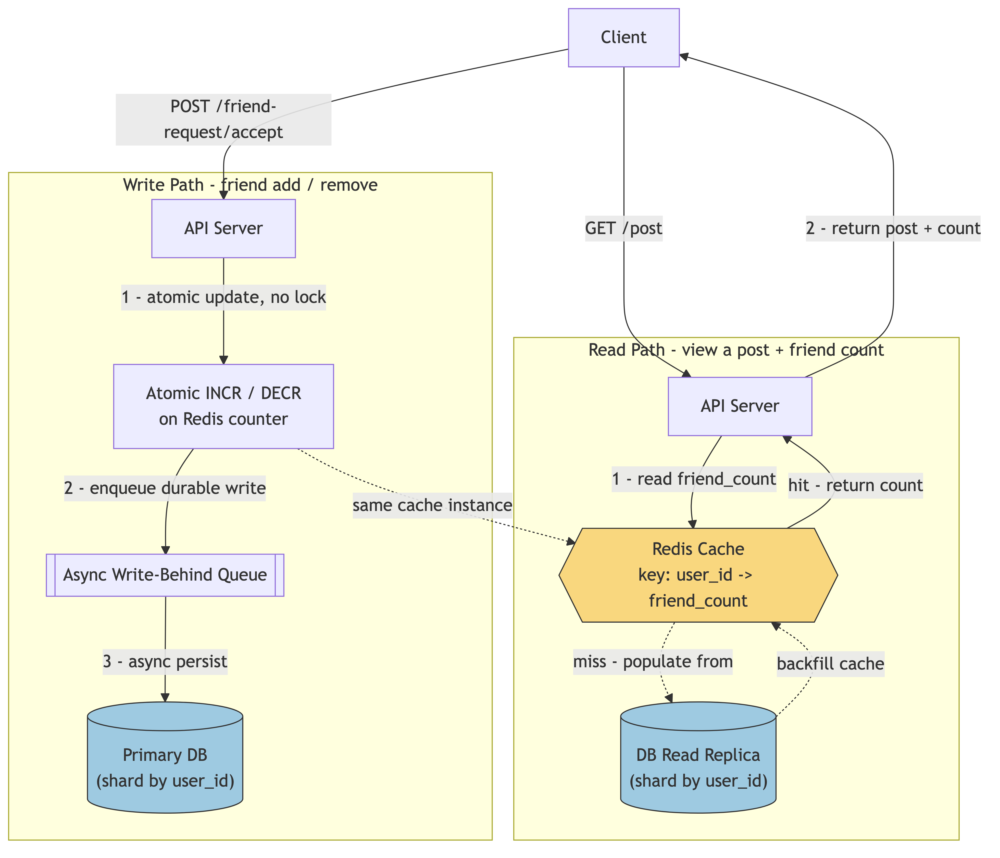
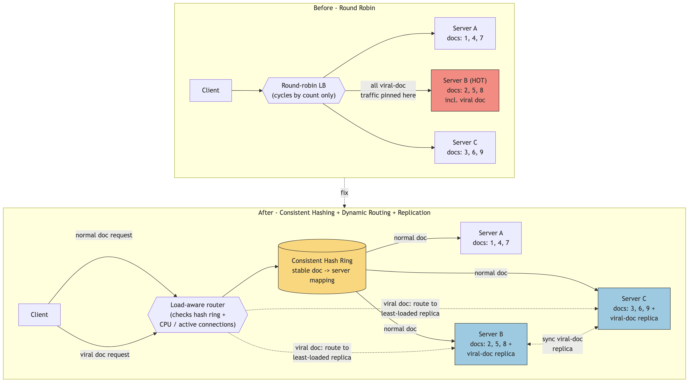

# Karat Round — Rapid-Fire System Design: Question & Answer

> Self-contained Q&A for the 10 confirmed questions in [`karat-p50-round.md`](karat-p50-round.md)'s Part 1. Condensed from the fully-worked, keyword-annotated versions in the [`system-design` repo](https://github.com/ShubhamChouksey123/system-design/blob/master/docs/company-specific/atlassian/karat-system-design-rapid-fire.md) — use *that* file if you want the constraint/tension breakdown per question; use *this* one for a fast last-pass read-through without jumping repos. ~2–3 min per question is the real-round budget — each answer below is sized to be sayable in that window.

---

**Q1. Design a Facebook-clone feature showing a user's current friend count next to every post, at massive read-heavy scale.**

A: Maintain a **denormalized counter** per user instead of computing it via a live join. Serve it from **Redis** (cache-aside), updated with an atomic `INCR`/`DECR` plus async write-behind to the DB. Shard by `user_id`, keep read replicas behind the cache for misses. The count can lag by milliseconds — **eventual consistency** is the right trade.

**Diagram**: 

---

**Q2. Critique: a Google-Docs-like system assigns each document to a single server via round-robin — what breaks?**

A: Round-robin only balances **assignment count**, not actual **load** — it cycles servers by sequence, with no concept of how busy each one actually is, and the assignment is made once at creation and never revisited.

Critique first — this is the graded skill, the fix is secondary:

| Failure | Why it happens |
|---|---|
| **Hotspots** | Doc popularity is power-law, not uniform. A doc that goes viral (hundreds of concurrent editors) overloads its one assigned server regardless of how "fair" the round-robin was at assignment time. |
| **No feedback loop** | The assignment never gets revisited — even if a server is visibly melting under load, nothing reroutes away from it. |
| **SPOF per document** | Every doc is pinned to exactly one server; that server crashing takes every doc assigned to it down with it, with no replica/failover. |

**Fix** — one change per failure above:

- **Consistent hashing** replaces round-robin for the base mapping — stable doc→server assignment that rebalances cheaply when servers are added/removed, instead of a static sequence. (Fixes capacity mismatch, bounds the SPOF blast radius to one hash-ring arc instead of a fixed server.)
- **Dynamic/least-loaded routing** layered on top — route by actual signal (active connections, CPU), not just an assignment counter, so a server trending hot sheds traffic. (Fixes the no-feedback-loop problem — note consistent hashing *alone* doesn't fix this, since a hashed-hot-doc still lands on one node.)
- **Replication / multi-leader fan-out** for a genuinely viral doc — let it escape single-server ownership entirely rather than solving virality purely at the load-balancer layer. (Fixes hotspots directly, and removes the single point of failure for that doc.)

**Diagram**: 

---

**Q3. Choose strong vs. eventual consistency for: (a) a low-latency video metadata API, (b) a web analytics/clickstream platform, (c) a banking system.**

A:

| System | Model | Why |
|---|---|---|
| (a) Low-latency video metadata API | **Eventual** | Staleness of seconds is fine; priority is low read latency at huge scale. Favor **availability** over consistency. |
| (b) Web analytics / clickstream platform | **Eventual, even more aggressively** | Append-only, high-throughput; nobody needs millisecond-fresh clicks. At-least-once ingestion + downstream dedup is the standard pattern. |
| (c) Banking system | **Strong** | A stale balance read or a double-spend is a correctness bug with real money attached. Needs ACID/quorum writes even at a latency cost. Favor **consistency** over availability. |

---

**Q4. A pipeline has stages with capacities 10, 20, and 50 docs/second — what's the max throughput, and how would you optimize it?**

A: Max throughput = **min(10, 20, 50) = 10 docs/sec** — bounded by the slowest stage. Optimize by scaling **only the bottleneck** (parallel workers on stage 1, fronted by a queue so it fans out without touching stages 2/3), then re-measure — the bottleneck moves to whichever stage is now smallest.

---

**Q5. Design a product-agnostic tagging system across Jira/Confluence/Bitbucket — add/remove tags, view all content for a tag, a popular-tags dashboard.**

A: Model entities with a composite key **`(entity_type, entity_id)`** so tags don't care what they're attached to. Store the forward mapping, but build an **inverted index** (`tag → [entity_ids]`) so "all content for tag X" is a direct lookup, not a scatter-gather. For the popular-tags dashboard, maintain a running counter per tag in a cached leaderboard (Redis sorted set) rather than recomputing on every load.

---

**Q6. Critique what goes wrong with consistent hashing for distributing load across music-streaming servers.**

A: Consistent hashing solves *rebalancing cost* on node churn, not *load uniformity* — a viral song's requests still all hash to one node (**hot-key skew**), and node churn still remaps the keys in that node's arc, dumping load suddenly onto whoever inherits them. Fix: **virtual nodes** to smooth distribution, plus **replication** of specific hot keys so their load fans out across multiple nodes instead of sitting on one.

---

**Q7. Pros/cons of shipping hints bundled with the app vs. fetching them from the server at runtime.**

A: **Pre-loaded** wins on latency/offline support but freezes content until the next release and bloats install size. **Server-loaded** wins on freshness/no-release-needed but costs a network round-trip and a connectivity dependency. **Middle ground:** ship a small default set pre-loaded for instant/offline fallback, then fetch and **cache with a TTL** server-side hints in the background.

---

**Q8. How do you process a file that doesn't fit in memory on a single machine?**

A: **Stream it in chunks** rather than loading it whole. For sorting-type work, use **external merge sort** — sort chunks that fit in memory, write to disk, merge. **Memory-mapped files** are a middle option, letting the OS page data in/out. If it's a recurring large-scale need, distribute **across workers** (MapReduce-style: split, process in parallel, combine).

---

**Q9. Design considerations for a service that classifies sports news for bias using ML.**

A: This is unusually ML-flavored — grade on the *systems* half, not the model. Put the model behind an **async inference queue** so ingestion never blocks on inference latency; serve it via a scalable inference service (batch where possible); **cache classification results** alongside the article so repeat reads skip re-inference; close the loop with a **feedback/retraining pipeline** for flagged misclassifications.

---

**Q10. What backend changes are needed when a production app expands beyond a single country?**

A: **Data residency/compliance** first (GDPR-style regional storage requirements) → drives regional data storage, not one global DB. **Latency** next — regional deployments or a CDN for cacheable content. **Locale/timezone handling** — don't bake in single-timezone/date-format assumptions. Finally, if data must sync across regions, that's an **eventual-consistency/conflict-resolution** problem, not a single-writer one.

---

## Drill Reminders

- **2–3 min each, verbal only** — restate constraint → name the tension → pick + justify with a keyword → stop. Don't improvise a full whiteboard design.
- Work 2–3 of the **interviewer-cue terms** into each answer: scalability, fault tolerance, availability, chunking, security, geo-availability.
- For "critique X" style questions (Q2, Q6): **critique before proposing** — naming what's wrong is the graded skill.
